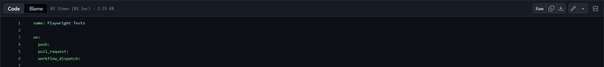
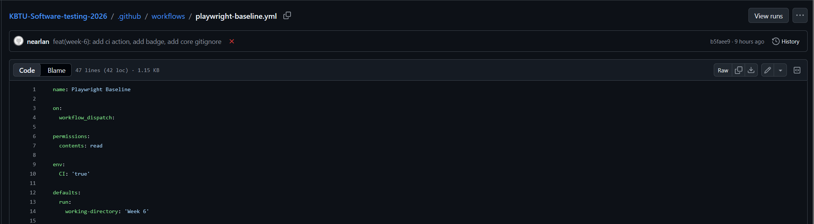
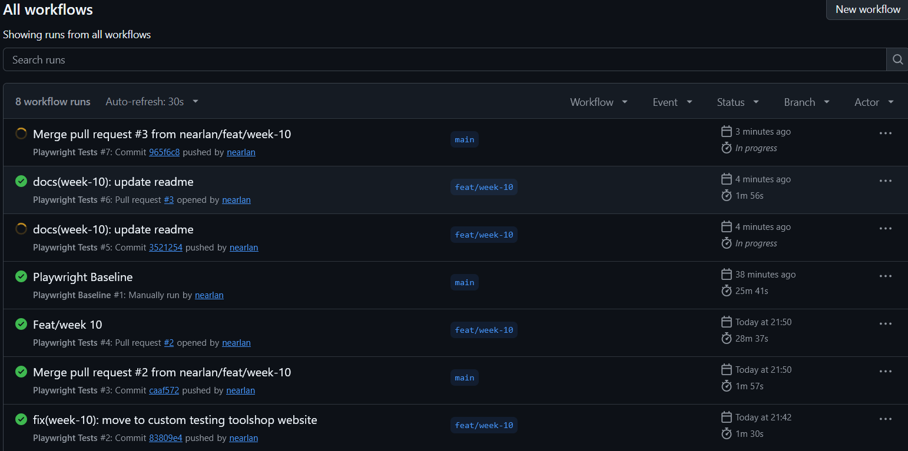
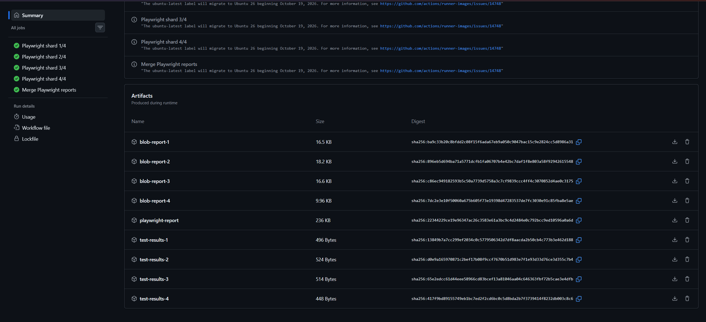
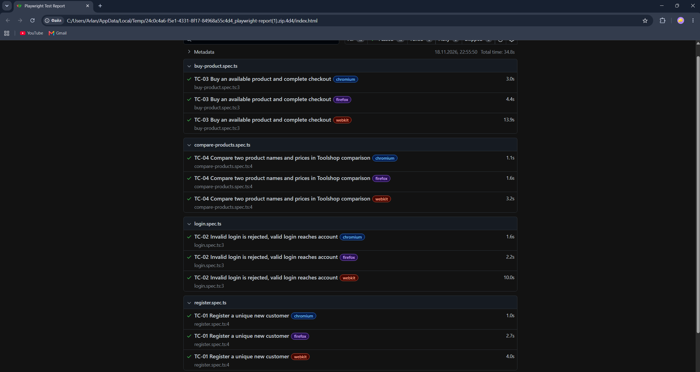
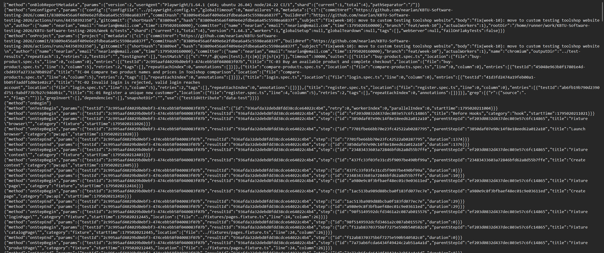
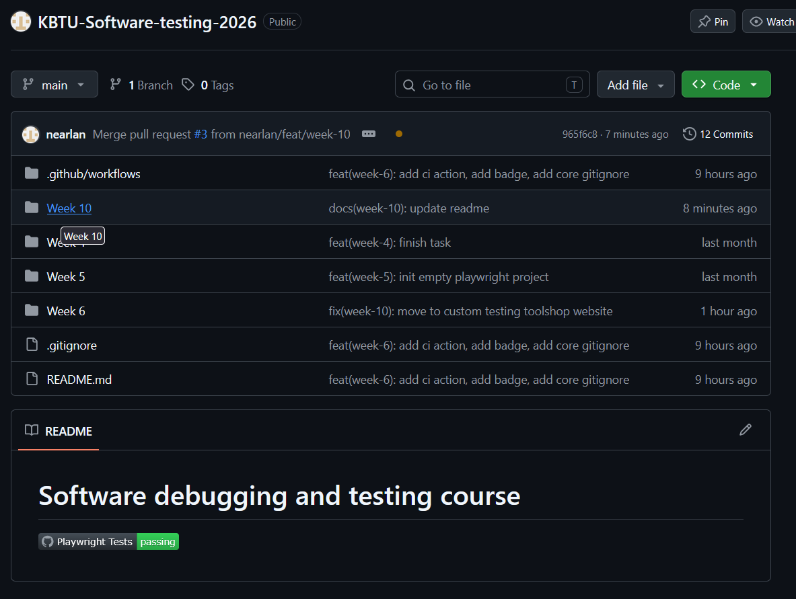

# Description
Github actions was used due repo lives in github. CI pipeline is for week 6 project

## Timing Table

| Configuration | Test execution | CI elapsed time | Run |
| --- | --- | --- | --- |
| Without sharding | 1 min 18 sec | 25 min 36 sec | [Link](https://github.com/nearlan/KBTU-Software-testing-2026/actions/runs/44357643313) |
| 4 shards | 30 sec | 1 min 54 sec | [Link](https://github.com/nearlan/KBTU-Software-testing-2026/actions/runs/44351920899) |

Results show, that parallel execution reduces test execution time.

## Etc
Because original [toolshop](https://practicesoftwaretesting.com/) uses cloudfare protection, which leads to timeout errors in github CI, so I made my deployed my own toolshop [website](https://kbtu-software-testing-toolshop-4306a314fc50.herokuapp.com) from original fork.

## Screenshots

Created CI, that triggers on PR, push and manually

Created CI with no shards, to compare with 4 shards

Completed and running jobs

Completed action artifacts

Playwright report from CI

JSON report from failed action (failed because of original website cloudfare protection)

README badge